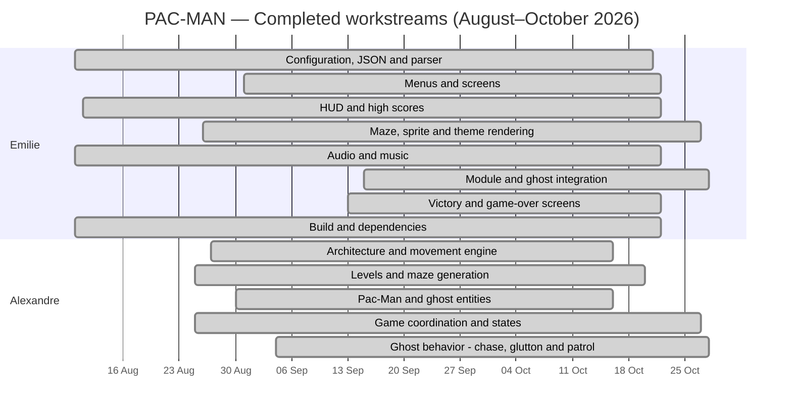

*This activity has been created as part of the 42 curriculum by **egouy**, **achevali***

# 
 PACMAN 

  

## Table of Contents

- 📝 [Description](#-description)
- 🛠️ [Instructions](#️-instructions)
  - [Requirements](#requirements)
  - [Installation & Setup](#installation--setup)
  - [Makefile Commands](#makefile-commands)
- ✅ [Configuration File](#-configuration-file)
- ✅ [Highscore](#-highscore)
- 🧩 [Maze Generation](#-maze-generation)
- 🏗️ [Architecture Overview](#️-architecture-overview)
  - [Project Layout Tree](#project-layout-tree)
  - [Config](#config)
  - [Entities & Ghosts](#entities--ghosts)
  - [Interface](#interface)
  - [Game](#game)
- 👻 [Ghost AI](#-ghost-ai)
  - [Ghost Interceptor — BFS pathfinding](#ghost-interceptor--bfs-pathfinding)
- 🕹️ [Cheat Mode](#️-cheat-mode)
- 🧪 [Tests](#-tests)
- 🤝 [Contributions](#-contributions)
- 🤖 [AI Usage](#-ai-usage)
- 📚 [Resources](#-resources)
- 📋 [Project Management](#-project-management)

# Description

# Instructions

# Configuration

# Highscore

# Cheat Mode

# Maze Generation

# Implementation 

# General Software Architecture

# Project Management

> **How to read the chart:** Each bar extends from the first to the last related Git commit for that workstream. It does **not** represent hours worked, continuous activity, or a formal task schedule. Completion statuses reflect the team’s confirmation.

## Completed workstreams

| Contributor | Workstream | First Git trace | Latest Git trace | Status |
|---|---|---|---|---|
| Emilie | Configuration, JSON and parser | 2026-08-10 | 2026-10-20 | Complete |
| Emilie | Menus and screens | 2026-08-31 | 2026-10-21 | Complete |
| Emilie | HUD and high scores | 2026-08-11 | 2026-10-21 | Complete |
| Emilie | Maze, sprite and theme rendering | 2026-08-26 | 2026-10-26 | Complete |
| Emilie | Audio and music | 2026-08-10 | 2026-10-21 | Complete |
| Emilie | Module and ghost integration | 2026-09-15 | 2026-10-27 | Complete |
| Emilie | Victory and game-over screens | 2026-09-13 | 2026-10-21 | Complete |
| Emilie | Build and dependencies | 2026-08-10 | 2026-10-21 | Complete |
| Alexandre | Architecture and movement engine | 2026-08-27 | 2026-10-15 | Complete |
| Alexandre | Levels and maze generation | 2026-08-25 | 2026-10-19 | Complete |
| Alexandre | Pac-Man and ghost entities | 2026-08-30 | 2026-10-15 | Complete |
| Alexandre | Game coordination and states | 2026-08-25 | 2026-10-26 | Complete |
| Alexandre | Ghost behavior - chase, glutton and patrol | 2026-09-04 | 2026-10-27 | Complete |

# Ressources 

---

*&copy; egouy, achevali 2025*