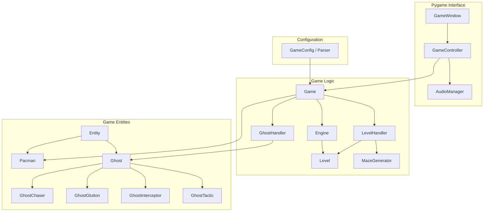
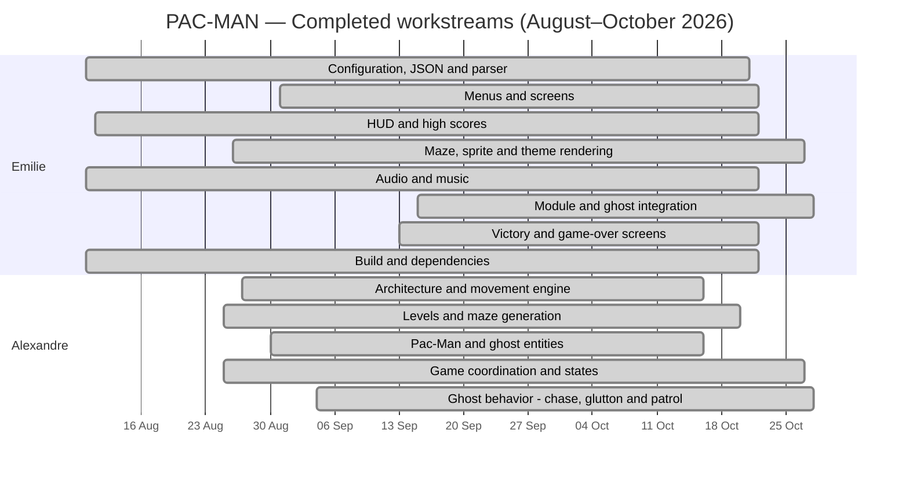

*This activity has been created as part of the 42 curriculum by egouy, achevali.*

# PACMAN

<p align="center">
  
</p>

## Table of Contents

- [Description](#description)
- [Instructions](#instructions)
- [Configuration](#configuration)
- [Highscore](#highscore)
- [Maze Generation](#maze-generation)
- [Implementation](#implementation)
- [General Software Architecture](#general-software-architecture)
- [Cheat Mode](#cheat-mode)
- [Project Management](#project-management)
- [Resources](#resources)

# Description

## Project Overview

This project is a **Pac-Man game developed in Python**, featuring procedurally generated mazes, multiple ghost artificial intelligence strategies, configurable gameplay settings, and a graphical interface built with **Pygame**.

Developed as a team project at **École 42**, it combines game engine development, algorithmic pathfinding, object-oriented programming, and real-time game state management.

The objective is to recreate the core mechanics of Pac-Man while introducing additional features, including randomized maze generation and distinct behaviors for each ghost.

### Gameplay

The player controls Pac-Man through a maze, collecting Pac-Gums and Super Gums while avoiding ghosts.

Each level introduces a procedurally generated maze, challenging the player to navigate different layouts and adapt to the ghosts' movement strategies.

The player must collect all required items before the level timer expires.

Super Gums temporarily weaken ghosts, allowing Pac-Man to eat them and earn additional points.

The game also includes a scoring system, persistent highscores, multiple levels, and cheat codes for testing and experimentation.

### Main Features

- **Procedural Maze Generation:** Randomized Depth-First Search (DFS) with backtracking and configurable seeds.
- **Bitmask-Based Maze Representation:** Compact wall encoding using four directional bits and bitwise operations.
- **Four Ghost AI Strategies:**
  - **Chaser:** Pursues Pac-Man using Breadth-First Search (BFS).
  - **Glutton:** Uses greedy movement based on Euclidean distance.
  - **Interceptor:** Predicts Pac-Man's position up to three cells ahead and uses BFS to intercept him.
  - **Tactic:** Patrols an assigned territory and switches to pursuit when Pac-Man enters its zone.
- **Dynamic Level System:** Multiple maze configurations with automatic level progression.
- **Game State Management:** Handles gameplay, countdowns, pauses, victory, and game-over conditions.
- **Entity State Management:** Supports normal movement, vulnerable ghosts, dead ghosts, and Pac-Man invincibility.
- **Scoring System:** Configurable points for collectibles and defeated ghosts.
- **Persistent Highscores:** JSON-based leaderboard storing the ten highest scores.
- **JSON Configuration:** Customizable gameplay settings validated with Pydantic.
- **Pygame Interface:** Graphical rendering, keyboard controls, animations, and audio effects.
- **Cheat Codes:** Extra lives, ghost freezing, invincibility, and level skipping.

### Technical Architecture

The project follows a modular, object-oriented architecture designed to separate the main responsibilities of the game.

The `Game` class acts as the central orchestrator, coordinating gameplay rules, collisions, scoring, timers, and level transitions.

The `Engine` handles movement validation using the maze's bitmask representation.

`Level` and `LevelHandler` manage maze data, collectibles, and level progression, while `MazeGenerator` handles procedural generation.

The entity system provides a shared foundation for Pac-Man and ghosts, allowing each ghost to implement its own movement strategy.

The graphical interface is managed with Pygame, while `GameController` connects gameplay events to the interface and audio system.

This organization keeps the core game logic largely independent of the rendering layer.

### Technologies and Concepts

| Technology / Concept | Usage |
|---|---|
| Python | Main programming language |
| Pygame | Graphical interface, input, and audio |
| Pydantic | Configuration validation |
| JSON | Configuration and highscore persistence |
| Object-Oriented Programming | Modular game architecture |
| Depth-First Search (DFS) | Procedural maze generation |
| Breadth-First Search (BFS) | Ghost pathfinding |
| Greedy Algorithms | Distance-based ghost movement |
| Manhattan Distance | Territorial pursuit limits |
| Euclidean Distance | Glutton movement decisions |
| Bitwise Operations | Maze wall representation |
| `time.monotonic()` | Gameplay timers and movement cooldowns |

### Project Goals

The project aims to:

- Build a playable Pac-Man game using Python.
- Implement procedural maze generation with reproducible results.
- Explore and compare different artificial intelligence strategies.
- Develop reusable classes for game entities and level management.
- Separate gameplay logic from rendering and user interaction.
- Manage real-time gameplay through timers and state transitions.
- Practice collaborative software development and integration.


# Instructions

### Requirements

Before installing and running the game, make sure you have:

- **Python 3**
- **pip**
- **venv**
- **Make**
- The dependencies listed in `requirements.txt`

The project uses a Python virtual environment named `pacmana`.

### Installation & Setup

Clone the repository and navigate to the project directory.

Create the virtual environment and install the required dependencies:

```bash
make install
```

This command:
1. Creates a virtual environment named `pacmana`.
2. Installs `mypy`.
3. Installs the dependencies from `requirements.txt`.

Activate the virtual environment:

```bash
source pacmana/bin/activate
```

### Running the Game

Start the game using the default configuration file (`config.json`):

```bash
make run
```

This executes:

```bash
python3 pac-man.py config.json
```

The configuration file can be modified to customize gameplay settings, including lives, scoring, maze dimensions, and level duration.

### Building and Running the Package

The project also supports a packaged version.

Build the Python package:

```bash
make build
```

Install the package and its dependencies:

```bash
make install_packages
```

**Note:** The `install_packages` target expects `pacman-0.0.1-py3-none-any.whl` in the project root. If the wheel is generated in `dist/`, its path must be adjusted in the Makefile.

Run the packaged version:

```bash
make run_pack
```

This executes:

```bash
python3 pac_man_build.py config.json
```

### Makefile Commands

| Command | Description |
|---|---|
| `make install` | Create the virtual environment and install dependencies. |
| `make install_packages` | Create the environment and install the Python package. |
| `make build` | Build the Python distribution. |
| `make run` | Launch the game with `config.json`. |
| `make run_pack` | Launch the packaged version. |
| `make debug` | Run the game using Python's debugger (`pdb`). |
| `make lint` | Run Flake8 and Mypy checks. |
| `make lint_strict` | Run Flake8 and strict Mypy checks. |
| `make clean` | Remove the virtual environment and Python cache directories. |

### Debugging

Run the game with Python's built-in debugger:

```bash
make debug
```

### Code Quality

Check the code using Flake8 and Mypy:

```bash
make lint
```

Run stricter type checking:

```bash
make lint_strict
```

These commands require `flake8` and `mypy` to be installed in the active environment.

### Cleaning

Remove the virtual environment and generated Python caches:

```bash
make clean
```

After cleaning, run `make install` again to recreate the environment.


- Python 3 with the project's supported version (verify the version in the repository).
- The Python dependencies used by the game include **Pygame** and **Pydantic**.
- A valid JSON configuration file.

# Configuration


The project includes a configuration system that allows players to customize gameplay settings without modifying the source code.

The system is built around two main components:

- **`Parser`** — Loads configuration data from a JSON file.
- **`GameConfig`** — Validates configuration data using Pydantic.

This separation ensures that configuration loading and validation remain independent of the game's core logic.

### 1. Configuration Workflow

The configuration is loaded before the game starts.

```text
JSON Configuration File
          |
          v
        Parser
          |
          v
   Raw Configuration
          |
          v
 GameConfig (Pydantic)
          |
          v
 Validated Configuration
          |
          v
      Game / Levels
```

**Initialization process:**

1. The user provides a JSON configuration file when launching the game.
2. `Parser` reads the file and extracts its contents.
3. The extracted data is passed to `GameConfig`.
4. Pydantic validates the configuration fields and their values.
5. The validated configuration is passed to the game.
6. Game components use these settings during initialization and gameplay.

### 2. Parser

**Role:** Reading and preparing configuration data.

The `Parser` class is responsible for loading the external configuration file.

**Responsibilities:**

- Reads configuration data from a JSON file.
- Makes the extracted data available to the configuration model.
- Separates file handling from configuration validation.

The parser exposes the following method:

```python
parser.build_config("config.json")
```

The resulting data can then be used to initialize `GameConfig`.

### 3. GameConfig

**Role:** Configuration validation and default values.

The `GameConfig` class is based on Pydantic's `BaseModel`.

It uses:

- **`Field`** to define default values and validation constraints.
- **`model_validator`** for custom validation and configuration preprocessing.
- **Type annotations** to enforce the expected structure of the configuration.

This prevents invalid configuration values from being passed directly into the game logic.

### 4. Configuration Parameters

The configuration model provides the following known parameters:

| Parameter | Default Value | Description |
|---|---|---|
| `highscore_filename` | `"highscore.json"` | Path to the highscore file. |
| `lives` | `3` | Initial number of lives. |
| `pacgum` | `42` | Configurable Pac-Gum parameter. |
| `pointperpacgum` | `10` | Points awarded for collecting a regular Gum. |
| `pointpersuperpacgum` | `50` | Points awarded for collecting a Super Gum. |
| `pointperghost` | `200` | Points awarded for eating a vulnerable ghost. |
| `levels` | 10 levels | List of maze dimensions for each level. |
| `levelsmaxtime` | `90` | Maximum level duration in seconds. |
| `seed` | `42` | Seed used for procedural maze generation. |

These values correspond to the previously shared `GameConfig` implementation.

### 5. Level Configuration

The `levels` field contains a list of dictionaries describing maze dimensions.

Each level defines:

- **`width`** — Maze width.
- **`height`** — Maze height.

**Example:**

```json
{
    "levels": [
        {"width": 21, "height": 21},
        {"width": 25, "height": 25},
        {"width": 29, "height": 29}
    ]
}
```

`LevelHandler` uses these dimensions to request maze generation for each level.

This allows different levels to use different maze sizes.

### 6. Configuration Validation

Pydantic ensures that configuration values satisfy the expected requirements.

**Known validation rules:**

| Parameter | Constraint |
|---|---|
| `lives` | Must be greater than 0. |
| `pacgum` | Must be greater than 0. |
| `pointperpacgum` | Must be greater than 0. |
| `pointpersuperpacgum` | Must be greater than 0. |
| `pointperghost` | Must be greater than 0. |
| `levelsmaxtime` | Must be greater than 0. |

The configuration model also defines expected Python types for its fields.

Custom validation can be performed through the `validate_data()` model validator.

### 7. Game Initialization

The game loads its configuration before creating the game window.

**Initialization example:**

```python
parser = Parser()
raw_data = parser.build_config(str(config_path))
config = GameConfig(**raw_data)
```

The validated configuration is then supplied to the game initialization process.

The entry point also checks whether the specified configuration file exists before attempting to load it.

If an error occurs during startup, an error message is displayed and the application exits.

### 8. Integration with Game Components

Different components use different parts of the configuration.

| Component | Configuration Usage |
|---|---|
| `Game` | Lives, scoring values, and gameplay settings. |
| `LevelHandler` | Level dimensions, maximum duration, and maze seed. |
| `MazeGenerator` | Maze dimensions and deterministic generation seed. |
| `Highscore` | Configurable leaderboard filename. |
| `GameWindow` | Receives the validated configuration during startup. |

### 9. Benefits of the Configuration System

- **Customization:** Gameplay settings can be modified through JSON.
- **Validation:** Pydantic checks values before gameplay begins.
- **Default values:** The model provides predefined settings.
- **Reproducibility:** Seeds allow specific maze layouts to be recreated.
- **Separation of responsibilities:** File loading, validation, and gameplay remain separate.
- **Maintainability:** Configuration changes do not require modifying the core game logic.


# Highscore

The game includes a configurable scoring system that rewards players for collecting items and eating vulnerable ghosts.

The `Game` class manages the score during gameplay, while the `Highscore` class handles leaderboard persistence using a JSON file.

### 1. Scoring System

Players earn points by collecting items in the maze and eating ghosts during the Super Gum effect.

The scoring values are defined through `GameConfig`, allowing them to be customized without modifying the game logic.

#### Default Point Values

| Action | Points | Description |
|---|---:|---|
| Collect a Gum | 10 | Earn points by collecting a regular Gum. |
| Collect a Super Gum | 50 | Earn points and temporarily weaken ghosts. |
| Collect a Fruit | 100 | Earn bonus points by collecting a fruit. |
| Eat a Weak Ghost | 200 | Earn points by catching a vulnerable ghost. |

These values can be configured through the game's configuration file.

### 2. Score Management in Game

The `Game` class is responsible for calculating and updating the player's score.

**Main responsibilities:**

- Initializes the player's score at the beginning of the game.
- Detects collectible consumption through the `Level` system.
- Maps collected objects to their corresponding point values.
- Adds points to the current score.
- Awards points when Pac-Man eats a ghost in the `WEAK` state.
- Maintains the player's score across level transitions.

The scoring system uses the `GridObject` and `GamePoint` enumerations to associate gameplay events with their corresponding rewards.

#### Scoring Workflow

1. Pac-Man moves to a valid position.
2. `Level` checks whether the destination contains a collectible.
3. The collected object is removed from the level.
4. `Game` identifies the object type.
5. The configured point value is added to the player's score.
6. The interface displays the updated score.

Ghost scoring is handled separately through collision detection.

When Pac-Man collides with a `WEAK` ghost, the ghost enters the `DEAD` state and the player receives the configured ghost points.

### 3. Highscore Management

The `Highscore` class manages a persistent leaderboard stored in a JSON file.

It is responsible for:

- Loading previously saved scores.
- Validating leaderboard entries.
- Sorting scores in descending order.
- Keeping only the 10 highest scores.
- Adding new player scores.
- Saving leaderboard data safely.
- Retrieving leaderboard entries.

The leaderboard file path is configurable.

### 4. Highscore File Format

Highscores are stored as a JSON array.

Each entry contains:

- `name`: The player's name.
- `score`: The player's score.

**Example:**

```json
[
    {
        "name": "PLAYER1",
        "score": 12500
    },
    {
        "name": "PLAYER2",
        "score": 9800
    },
    {
        "name": "PLAYER3",
        "score": 7200
    }
]
```

Scores are ordered from highest to lowest.

### 5. Highscore Validation

The `Highscore` class validates entries before accepting them.

#### Player Name Rules

- Must be a string.
- Must contain between 1 and 10 characters.
- Can contain letters, numbers, and spaces.
- Cannot contain special characters.

#### Score Rules

- Must be an integer.
- Must be greater than or equal to zero.
- Boolean values are rejected.
- Negative scores are not accepted.

Invalid entries found while loading a leaderboard are ignored.

Invalid values passed to `add_score()` are rejected without modifying the leaderboard.

### 6. Leaderboard Ranking

The leaderboard stores a maximum of **10 entries**.

When a new score is submitted:

1. The player's name and score are validated.
2. The new entry is added to a copy of the existing leaderboard.
3. All entries are sorted by score in descending order.
4. Only the 10 highest entries are retained.
5. The updated leaderboard is saved to the JSON file.

A valid submitted score is not guaranteed to appear in the final top 10 if higher scores already occupy every position.

The `top_score(n)` method retrieves the first `n` entries from the leaderboard.

### 7. Safe Highscore Storage

The `Highscore` class uses a temporary file to reduce the risk of corrupting leaderboard data during saving.

**Saving process:**

1. Write the leaderboard to a temporary `.tmp` file.
2. Flush buffered data.
3. Synchronize the temporary file using `os.fsync()`.
4. Replace the original file using `os.replace()`.
5. Return `True` when the operation succeeds.

If saving fails:

- A warning message is displayed.
- The temporary file is removed when possible.
- The method returns `False`.
- `add_score()` restores the previous in-memory leaderboard.

This approach helps protect previously saved scores from incomplete write operations.

### 8. Missing or Invalid Highscore Files

The system handles missing and invalid leaderboard files.

**Missing file:**
- Displays a warning.
- Initializes an empty leaderboard.
- Attempts to create a new JSON file.

**Invalid file:**
- Displays a warning when the file cannot be parsed or has an invalid top-level format.
- Initializes an empty in-memory leaderboard.

**Partially invalid data:**
- Ignores invalid entries.
- Preserves valid entries.
- Sorts and limits the resulting leaderboard to 10 scores.

### 9. Component Responsibilities

| Component | Responsibility |
|---|---|
| `Game` | Maintains the current score and awards points during gameplay. |
| `Level` | Manages collectible objects and their consumption. |
| `GridObject` | Identifies collectible types. |
| `GamePoint` | Associates scoring events with their point categories. |
| `GameConfig` | Defines configurable point values and the highscore filename. |
| `Highscore` | Validates, ranks, loads, and saves leaderboard entries. |
| `GameController` / Interface | Displays score information through the game interface. |

### 10. Scoring System Benefits

- **Configurable:** Point values can be changed through game configuration.
- **Centralized:** Gameplay scoring is managed by `Game`.
- **Persistent:** Highscores are stored between sessions.
- **Validated:** Invalid names and scores are rejected.
- **Ranked:** The leaderboard retains the 10 highest entries.
- **Reliable:** Temporary-file replacement reduces the risk of incomplete saves.
- **Reusable:** The `Highscore` class is independent of Pygame rendering.


# Maze Generation

### A-Maze-ing Package Integration

The maze generation workflow uses `MazeGenerator` from the project's maze-generation component: `LevelHandler` requests a maze using level dimensions and a seed, the resulting bitmask grid is given to `Level`, and `Engine` uses the same wall encoding for movement validation.

> **To complete before submission:** The assignment explicitly asks how the **assigned A-Maze-ing package** is used. Verify the package's actual import/module path and explain whether `MazeGenerator` comes from that package or is an adapted implementation. The supplied README does not establish that relationship, so it should not be asserted without checking the source.


The project uses a procedural maze generator based on a randomized **Depth-First Search (DFS)** algorithm with backtracking.

The generator creates reproducible mazes using a configurable seed and represents their walls using a **4-bit bitmask system**.

This representation is shared between `MazeGenerator` and `Engine`, allowing maze generation and movement validation to use the same data structure.

### 1. Maze Generation — Randomized DFS

The generator uses a randomized DFS algorithm to construct the maze.

**Generation process:**

1. Initialize a grid containing walls.
2. Select a starting cell.
3. Identify neighboring cells that have not yet been visited.
4. Randomly select an unvisited neighbor.
5. Remove the wall separating the current cell and the selected neighbor.
6. Continue exploring until no unvisited neighbor remains.
7. Backtrack to the previous cell.
8. Repeat until the generation is complete.

The resulting maze contains connected passages generated through randomized exploration.

### 2. Seed-Based Generation

The generator accepts a configurable random seed.

- The same seed and dimensions produce the same maze.
- Different seeds can generate different layouts.
- Seeds make maze generation reproducible for debugging and testing.
- `LevelHandler` manages the generation of successive levels.

### 3. Bitmask Wall Representation

Each cell is represented by an integer containing information about its four surrounding walls.

Each direction is assigned a specific bit:

| Direction | Binary | Decimal | Hexadecimal |
|---|---|---|---|
| North | `0001` | `1` | `0x1` |
| East | `0010` | `2` | `0x2` |
| South | `0100` | `4` | `0x4` |
| West | `1000` | `8` | `0x8` |

Each bit indicates whether a wall exists in a particular direction:

- **Bit = 1:** The wall is present.
- **Bit = 0:** The wall is absent, allowing movement in that direction.

For example, a cell surrounded by walls has the following representation:

```text
Binary:      1111
Decimal:     15
Hexadecimal: 0xF
```

A cell without walls has:

```text
Binary:      0000
Decimal:     0
Hexadecimal: 0x0
```

### 4. Combining Walls with Bitwise OR

Multiple walls can be stored in a single integer using the **bitwise OR (`|`) operator**.

For example, a cell with North and East walls:

```text
North: 0001
East:  0010
       ----
OR:    0011
```

The resulting value is `3` (`0x3`).

This means the cell has walls to the North and East, while movement is possible to the South and West.

### 5. Removing Walls During Maze Generation

During DFS generation, the algorithm connects neighboring cells by removing the walls between them.

The two adjacent cells must be updated consistently.

For example, when creating a passage from cell A to cell B in the East direction:

- Remove the East wall from cell A.
- Remove the West wall from cell B.

The generator can remove a wall using a bitwise operation:

```python
cell &= ~wall_bit
```

Where:

- `wall_bit` identifies the wall to remove.
- `~` inverts the bitmask.
- `&=` updates the cell while preserving its other wall bits.

**Example:**

```text
Initial cell A: 1111
East bit:       0010
                ----
Result:         1101
```

The East wall is removed, while North, South, and West remain.

For the neighboring cell B:

```text
Initial cell B: 1111
West bit:       1000
                ----
Result:         0111
```

The West wall is removed.

This ensures that both cells agree on the existence of the passage.

### 6. Opposite Wall Mapping

To maintain consistency, the project uses a mapping between each wall and its opposite:

| Direction | Bit | Opposite Direction | Opposite Bit |
|---|---|---|---|
| North | `1` | South | `4` |
| East | `2` | West | `8` |
| South | `4` | North | `1` |
| West | `8` | East | `2` |

The corresponding mapping is:

```python
opposite_bits = {
    1: 4,
    2: 8,
    4: 1,
    8: 2,
}
```

This mapping is useful for both maze generation and movement validation.

### 7. Movement Validation in Engine

The `Engine` uses the bitmask grid to determine whether an entity can move between adjacent cells.

For a movement to be valid, the engine checks:

1. The destination is inside the maze boundaries.
2. The current cell has no wall blocking the requested direction.
3. The destination cell has no wall blocking movement from the opposite direction.

For example, moving East requires:

- The East bit (`2`) to be absent in the current cell.
- The West bit (`8`) to be absent in the destination cell.

A bit can be tested using **bitwise AND (`&`)**:

```python
cell & wall_bit
```

A non-zero result indicates that the corresponding wall is present.

A zero result indicates that the wall is absent.

**Example:**

```text
Current cell: 1101
East bit:     0010
              ----
AND:          0000
```

The East wall is absent, so movement is not blocked by the current cell.

The engine must also verify the opposite wall in the destination cell.

### 8. Example Maze Representation

A small portion of a maze might be represented as:

```text
Hexadecimal grid:

F  D  7
B  A  E
F  5  7
```

Each hexadecimal value corresponds to four wall bits.

For example:

| Hex | Binary | Walls |
|---|---|---|
| `F` | `1111` | North, East, South, West |
| `D` | `1101` | North, South, West |
| `7` | `0111` | North, East, South |
| `B` | `1011` | North, East, West |
| `A` | `1010` | East, West |
| `E` | `1110` | East, South, West |
| `5` | `0101` | North, South |

This example illustrates how wall configurations are encoded. It is not intended to represent a validated, connected maze.

### 9. Special Maze Features

The generator includes project-specific maze features.

**42 Motif**

- Incorporates a special `42` pattern into the maze structure.
- Adds a visual reference to École 42.

**Reserved Areas**

- Supports areas that are excluded from normal maze carving.
- Allows certain structures to be preserved during generation.

### 10. Integration with the Game

The maze generation and movement system follows this workflow:

1. `LevelHandler` requests a maze from `MazeGenerator`.
2. `MazeGenerator` creates the maze using DFS, dimensions, and a seed.
3. Wall information is stored as bitmask integers.
4. `Level` receives the generated grid and initializes gameplay elements.
5. `Engine` validates movements using the wall bits.
6. Pac-Man and ghosts navigate the same grid through the movement system.

### 11. Advantages of the Bitmask System

- **Compact representation:** Four wall states are stored in a single integer.
- **Fast validation:** Bitwise operations make wall checks efficient.
- **Consistency:** Opposite wall mappings ensure adjacent cells can be checked symmetrically.
- **Simple pathfinding integration:** Ghost algorithms can use the same movement rules as Pac-Man.
- **Reproducibility:** Seed-based generation enables deterministic testing.
- **Separation of responsibilities:** The generator creates mazes, while the engine validates movements.

**Overall approach:** Randomized DFS creates the maze, bitmasks represent its walls, and the Engine interprets those bits to determine valid movements.

# Implementation

## Technical Implementation Summary

The game logic is implemented in Python, with Pygame responsible for rendering, input and sound. A shared `Engine` validates movement using four-bit wall masks, while `Level` and `LevelHandler` manage collectibles, timers and progression. `MazeGenerator` builds seeded mazes using randomized depth-first search.

The ghost AI layer combines BFS shortest-path search (Chaser), Euclidean-distance greedy movement (Glutton), direction-based interception with BFS (Interceptor), and BFS-based territorial patrol with a Manhattan-distance pursuit limit (Tactic). Gameplay transitions and temporary effects are handled through enumerated states and `time.monotonic()`. The scoring system uses configurable point values and saves leaderboard entries as JSON.

## State Management

The game uses an enum-based state system to control gameplay progression, entity behavior, collisions, and temporary effects.

Two main state categories are used:

- **`StateGame`** — Controls the overall game flow.
- **`EntityState`** — Controls the behavior and status of Pac-Man and ghosts.

This separation allows the game to manage global gameplay events independently of individual entity states.

### 1. Game States — `StateGame`

The `Game` class manages the overall game state through the `gamestate` attribute.

| State | Description |
|---|---|
| `NEW` | Initial state before gameplay begins. |
| `RESUME` | Active gameplay: Pac-Man and ghosts can move. |
| `PAUSE` | Gameplay is temporarily suspended. |
| `VICTORY` | The player has successfully completed all levels. |
| `GAMEOVER` | The game ends when the player runs out of lives or time. |

#### NEW

The `NEW` state is used when starting the game or entering a new level.

- Starts a countdown before gameplay begins.
- Prevents entities from moving during the countdown.
- Transitions to `RESUME` when the countdown finishes.
- Initializes the level timer when gameplay starts.

#### RESUME

The `RESUME` state represents active gameplay.

- Processes Pac-Man's movement.
- Updates ghost movement and AI behavior.
- Checks collisions between entities.
- Handles collectibles and scoring.
- Updates temporary effects and timers.
- Checks level completion and game-over conditions.

#### PAUSE

The `PAUSE` state temporarily suspends gameplay.

- Stops normal gameplay updates.
- Prevents entities from moving.
- Preserves the remaining level time.
- Compensates time references when gameplay resumes.

The timer adjustment relies on `time.monotonic()` to avoid counting paused time as active gameplay time.

#### VICTORY

The `VICTORY` state is reached when all levels have been completed.

- Stops normal gameplay updates.
- Marks the game as successfully completed.
- Allows the interface to display the victory screen.
- Triggers the victory sound through the audio system.

#### GAMEOVER

The `GAMEOVER` state is reached when the game can no longer continue.

Possible conditions include:

- Pac-Man has no remaining lives.
- The current level's time limit expires before completion.

The state stops gameplay and allows the interface to display the game-over screen.

### 2. Entity States — `EntityState`

Entities have their own states, independent of the global game state.

| State | Applies To | Description |
|---|---|---|
| `NORMAL` | Pac-Man / Ghosts | Standard movement and collision behavior. |
| `WEAK` | Ghosts | Ghosts become vulnerable after Pac-Man consumes a Super Gum. |
| `DEAD` | Ghosts | Eaten ghosts return toward their starting position. |
| `INVINCIBLE` | Pac-Man | Pac-Man cannot lose lives through ghost collisions. |

#### NORMAL

The default state for both Pac-Man and ghosts.

**Pac-Man:**
- Moves according to player input.
- Can lose a life when colliding with a dangerous ghost.

**Ghosts:**
- Follow their individual AI strategies.
- Can harm Pac-Man upon collision.

#### WEAK

The `WEAK` state is activated when Pac-Man consumes a Super Gum.

- Ghosts become vulnerable to Pac-Man.
- Their movement behavior changes.
- Pac-Man can eat them by making contact.
- Eating a weak ghost awards points.
- The effect lasts for a limited duration.

The game tracks the effect duration using `time.monotonic()`.

When the effect expires, vulnerable ghosts return to their normal state.

#### DEAD

A ghost enters the `DEAD` state after being eaten by Pac-Man while vulnerable.

- The ghost no longer causes normal collision damage.
- It returns toward its spawn position.
- Its movement follows the shared dead-state behavior.
- It eventually returns to `NORMAL` when the appropriate conditions are met.

The game also accounts for temporary effects to prevent ghosts from immediately becoming vulnerable again in situations that could allow repeated scoring.

#### INVINCIBLE

The `INVINCIBLE` state is used by Pac-Man's invincibility cheat code.

- Pac-Man continues moving normally.
- Ghost collisions do not cause a loss of life.
- Disabling invincibility restores the normal collision rules.

### 3. Ghost State Transitions

Ghosts can transition between states according to gameplay events.

```text
              Super Gum
   NORMAL ----------------> WEAK
      ^                       |
      |                       | Eaten by Pac-Man
      |                       v
      +--------------------- DEAD
         Return to spawn
         under valid conditions

   WEAK -------------------> NORMAL
          Power-up expires
```

The global `Game` logic coordinates these transitions.

### 4. State Management Responsibilities

| Component | Responsibility |
|---|---|
| `Game` | Manages global game states and entity interactions. |
| `Pacman` | Stores Pac-Man's current entity state. |
| `Ghost` | Stores ghost states and provides state-dependent movement behavior. |
| `GhostHandler` | Provides access to ghost instances. |
| `Level` | Tracks level progression and time limits. |
| `GameController` | Connects gameplay state changes to interface and audio events. |

### 5. State Separation

The state system distinguishes between:

**Global game state**
- Determines whether gameplay is running, paused, completed, or over.

**Entity state**
- Determines how individual entities behave and interact.

**Ghost AI mode**
- Determines the movement strategy of a particular ghost.

For example, `GhostTactic` uses `PATROL` and `CHASE` as AI modes. These are separate from its `NORMAL`, `WEAK`, and `DEAD` entity states.

This means a ghost can have an entity state and an AI mode without mixing the two concepts.

### 6. Benefits of the State System

- **Clear responsibilities:** Global and entity behaviors are handled separately.
- **Predictable transitions:** Gameplay events determine state changes.
- **Reusable behavior:** Ghosts share state rules while keeping their own AI strategies.
- **Timer integration:** Temporary effects use monotonic time measurements.
- **Easier testing:** States can be tested individually for movement, collisions, and level progression.

# General Software Architecture


The Pac-Man project is organized into several components to separate game logic, maze management, entity behavior, configuration, and the Pygame interface.

### Architecture Diagram



### Component Responsibilities

#### GameWindow

**Role:** Pygame interface and rendering.

- Creates and manages the game window.
- Handles keyboard input and Pygame events.
- Displays the maze, Pac-Man, ghosts, and game information.
- Coordinates the visual updates of the game.

#### GameController

**Role:** Connection between the interface and game logic.

- Calls the `Game` update method.
- Detects gameplay events relevant to the interface.
- Triggers the appropriate sound effects through `AudioManager`.
- Keeps interface-specific behavior separate from the game rules.

#### AudioManager

**Role:** Sound management.

- Manages game sound effects.
- Plays sounds associated with gameplay events.
- Centralizes audio handling.

#### Game

**Role:** Main game logic and orchestration.

- Coordinates Pac-Man, ghosts, levels, and the engine.
- Manages the score and remaining lives.
- Handles collisions between entities.
- Manages the consumption of gums and super gums.
- Controls ghost states and temporary effects.
- Handles game timers, pauses, and freezing.
- Manages level transitions, victory, and game over conditions.

#### Engine

**Role:** Maze movement validation.

- Stores the active maze grid.
- Checks whether positions and movements are valid.
- Uses the maze's wall representation to prevent invalid movements.
- Provides movement validation shared by Pac-Man and ghosts.

#### Level

**Role:** Individual level management.

- Stores the maze and its grid objects.
- Tracks remaining collectible elements.
- Manages the level timer.
- Detects when a level has been completed.
- Provides information about the level's corners and layout.

#### LevelHandler

**Role:** Level progression.

- Creates and stores the game's levels.
- Uses `MazeGenerator` to generate maze layouts.
- Tracks the currently active level.
- Handles progression to the next level.

#### MazeGenerator

**Role:** Procedural maze generation.

- Generates maze layouts based on dimensions and a seed.
- Provides reproducible maze generation.
- Produces the wall grid used by the engine and levels.

#### GhostHandler

**Role:** Ghost management.

- Maintains the collection of ghosts.
- Assigns ghost spawn positions.
- Coordinates the initialization of ghost-specific information.
- Provides access to the ghosts for the main game logic.

#### Entity

**Role:** Base class for movable entities.

- Stores common entity information.
- Manages positions and movement-related attributes.
- Provides shared movement and reset behavior.
- Acts as the parent class for Pac-Man and ghosts.

#### Pacman

**Role:** Player-controlled entity.

- Receives and buffers movement directions.
- Manages Pac-Man's movement.
- Stores Pac-Man's current and starting positions.
- Interacts with the game engine for movement validation.

#### Ghost

**Role:** Base class for ghost entities.

- Provides common ghost attributes and movement behavior.
- Manages shared movement data and pathfinding queues.
- Supports the `NORMAL`, `WEAK`, and `DEAD` states.
- Acts as the parent class for the four specialized ghosts.

---

### Ghost AI Behaviors

The game features **four ghosts**, each with a distinct movement strategy. Their different algorithms create unique challenges and encourage players to adapt their movements.

#### 1. Chaser — BFS Pursuit

The **Chaser** uses **Breadth-First Search (BFS)** to pursue Pac-Man through the maze.

**Behavior:**
- Calculates a shortest path toward Pac-Man's position.
- Explores accessible cells while respecting maze walls.
- Uses a movement queue to follow the calculated path.
- Calculates a new path when necessary.

**Strategy:** Direct pursuit using shortest-path navigation.

#### 2. Glutton — Greedy Pursuit

The **Glutton** uses a **greedy algorithm based on Euclidean distance** to approach Pac-Man.

**Behavior:**
- Evaluates available movement directions.
- Calculates the Euclidean distance between candidate positions and Pac-Man.
- Prioritizes movements that minimize this distance.
- Makes local decisions without calculating a complete path through the maze.

**Strategy:** Aggressive, locally optimized pursuit.

#### 3. Interceptor — Predictive Pathfinding

The **Interceptor** combines predictive targeting with **Breadth-First Search (BFS)** to intercept Pac-Man.

**Behavior:**
- **Predictive targeting:** Identifies an interception point up to three cells ahead of Pac-Man, based on his current movement direction.
- **Wall awareness:** Stops projecting Pac-Man's position if a wall or invalid movement blocks the predicted route.
- **Shortest-path navigation:** Uses BFS to find a shortest path toward the interception point.
- **Dynamic pathfinding:** Recalculates its path during normal movement to adapt to Pac-Man's changing position and direction.
- **Fallback targeting:** Pursues Pac-Man's current position if his direction is unavailable.

**Strategy:** Anticipate Pac-Man's trajectory and intercept him using predictive targeting and shortest-path navigation.

#### 4. Tactic — Territorial Patrol

The **Tactic** ghost uses a territorial AI with two distinct modes: `PATROL` and `CHASE`.

Its territory is determined by its spawn position and corresponds to one of the maze's four quadrants.

**PATROL Mode:**
- Selects random destinations inside its assigned territory.
- Uses BFS to navigate between patrol destinations.
- Selects a new destination after reaching the previous one.
- Returns to its territory after abandoning a pursuit.

**CHASE Mode:**
- Activates when Pac-Man enters its territory and the ghost is also inside it.
- Uses BFS to pursue Pac-Man.
- Can follow Pac-Man outside its assigned territory.
- Abandons the pursuit when its Manhattan distance beyond the territory exceeds four cells.
- Clears its current path when switching between modes.
- Must return to its territory before starting another pursuit.

**Strategy:** Territorial defense, alternating between local patrol and limited-distance pursuit.

#### Shared Ghost States

In addition to their individual AI strategies, ghosts use a shared state system:

| State | Description |
|---|---|
| `NORMAL` | The ghost follows its normal movement strategy. |
| `WEAK` | The ghost becomes vulnerable after Pac-Man consumes a Super Gum. |
| `DEAD` | After being eaten by Pac-Man, the ghost returns toward its spawn position. |

These states allow the game to temporarily modify ghost behavior independently of its normal AI strategy.

---

### Configuration Components

#### Parser

**Role:** Configuration file loading.

- Reads the JSON configuration file.
- Extracts configuration values.
- Passes the loaded data to the configuration model.

#### GameConfig

**Role:** Game configuration validation.

- Defines the configurable game parameters.
- Validates configuration values using Pydantic.
- Provides settings such as lives, scoring, level dimensions, timers, and maze seeds.

---

### Architectural Principles

The project follows a separation of responsibilities:

- **Interface layer:** Handles rendering, player input, and audio.
- **Game logic layer:** Controls gameplay rules, progression, interactions, and timers.
- **Maze layer:** Handles procedural generation, level data, and movement validation.
- **Entity layer:** Encapsulates Pac-Man and ghost movement behaviors.
- **Configuration layer:** Loads and validates game settings.

The `Game` class acts as the central orchestrator, while `GameController` connects it to the Pygame interface.

This structure allows the core game logic to remain largely independent of the rendering system.


# Cheat Mode

The game includes four cheat codes that allow players to modify gameplay behavior.

These features can also be used for testing and debugging.

### Available Cheat Codes

| Cheat Code | Effect | Description |
|---|---|---|
| Extra Lives | 99 Lives | Sets Pac-Man's remaining lives to 99. |
| Ghost Freeze | Toggle ON/OFF | Freezes ghost movement while allowing Pac-Man to continue moving. |
| Invincibility | Toggle ON/OFF | Makes Pac-Man immune to ghost collisions. |
| Level Skip | Next Level | Allows the player to skip the current level and advance to the next one. |

### Cheat Code Details

#### Extra Lives

Sets Pac-Man's remaining lives to **99**, allowing extended gameplay without frequently reaching Game Over.

#### Ghost Freeze

Temporarily freezes all ghost movement.

- Pac-Man can continue moving normally.
- Ghost collisions remain active.
- Deactivating the cheat restores ghost movement.

#### Invincibility

Allows Pac-Man to move without losing lives from ghost collisions.

- Switches Pac-Man between `NORMAL` and `INVINCIBLE` states.
- Deactivating the cheat restores normal collision behavior.

#### Level Skip

Allows the player to advance directly to the next level without collecting all the remaining gums.

- Skips the current level.
- Advances the level progression.
- Allows developers to test different levels without completing each one.

### Reset Behavior

When changing levels:

- Ghost Freeze is disabled.
- Pac-Man's invincibility is disabled.
- Normal ghost behavior is restored.

# Project Management

The team tracked its work by contributor and workstream, including configuration and interface development, core engine and AI development, and integration. The timeline below summarizes the Git activity associated with those workstreams; commit ranges are not estimates of hours spent.

**Dedicated project management directory:** _[Add the verified relative link to the project's management directory before submission]._



> **How to read the chart:** Each bar extends from the first to the last related Git commit for that workstream. It does **not** represent hours worked, continuous activity, or a formal task schedule. Completion statuses reflect the team’s confirmation.

## Completed workstreams

| Contributor | Workstream | First Git trace | Latest Git trace | Status |
|---|---|---|---|---|
| Emilie | Configuration, JSON and parser | 2026-08-10 | 2026-10-20 | Complete |
| Emilie | Menus and screens | 2026-08-31 | 2026-10-21 | Complete |
| Emilie | HUD and high scores | 2026-08-11 | 2026-10-21 | Complete |
| Emilie | Maze, sprite and theme rendering | 2026-08-26 | 2026-10-26 | Complete |
| Emilie | Audio and music | 2026-08-10 | 2026-10-21 | Complete |
| Emilie | Module and ghost integration | 2026-09-15 | 2026-10-27 | Complete |
| Emilie | Victory and game-over screens | 2026-09-13 | 2026-10-21 | Complete |
| Emilie | Build and dependencies | 2026-08-10 | 2026-10-21 | Complete |
| Alexandre | Architecture and movement engine | 2026-08-27 | 2026-10-15 | Complete |
| Alexandre | Levels and maze generation | 2026-08-25 | 2026-10-19 | Complete |
| Alexandre | Pac-Man and ghost entities | 2026-08-30 | 2026-10-15 | Complete |
| Alexandre | Game coordination and states | 2026-08-25 | 2026-10-26 | Complete |
| Alexandre | Ghost behavior - chase, glutton and patrol | 2026-09-04 | 2026-10-27 | Complete |

# Resources

### References

- [Python documentation](https://docs.python.org/3/) — Language features, collections, enums, JSON and `time.monotonic()`.
- [Pygame documentation](https://www.pygame.org/docs/) — Display, keyboard events, rendering, sound and game loops.
- [Pydantic documentation](https://docs.pydantic.dev/latest/) — Configuration models, fields and validators.
- [Python `collections.deque`](https://docs.python.org/3/library/collections.html#collections.deque) — Queue operations used by BFS.
- [Python `json` module](https://docs.python.org/3/library/json.html) — Configuration and highscore persistence.

### AI Usage

AI assistance (ChatGPT) was used to discuss algorithms and Python concepts, and help draft and organize the README documentation. Topics included BFS and DFS, bitmask wall representation, Manhattan distance, timers with `time.monotonic()`.