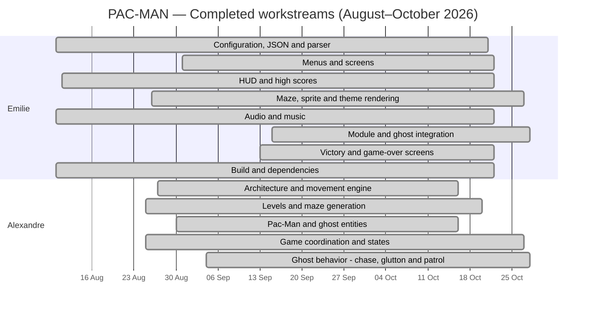

# PAC-MAN — Project Tracking & Gantt Chart

**Project status:** Complete (13/13 workstreams — 100%)  
**Observed Git history:** August 5 – October 27, 2026  
**Contributors:** Emilie (egouy / studio) and Alexandre (achevali)

## Project Gantt chart

> **How to read the chart:** Each bar extends from the first to the last related Git commit for that workstream. It does **not** represent hours worked, continuous activity, or a formal task schedule. Completion statuses reflect the team’s confirmation.

## Completed workstreams

| Contributor | Workstream | First Git trace | Latest Git trace | Status |
|---|---|---|---|---|
| Emilie | Configuration, JSON and parser | 2026-08-10 | 2026-10-20 | Complete |
| Emilie | Menus and screens | 2026-08-31 | 2026-10-21 | Complete |
| Emilie | HUD and high scores | 2026-08-11 | 2026-10-21 | Complete |
| Emilie | Maze, sprite and theme rendering | 2026-08-26 | 2026-10-26 | Complete |
| Emilie | Audio and music | 2026-08-10 | 2026-10-21 | Complete |
| Emilie | Module and ghost integration | 2026-09-15 | 2026-10-27 | Complete |
| Emilie | Victory and game-over screens | 2026-09-13 | 2026-10-21 | Complete |
| Emilie | Build and dependencies | 2026-08-10 | 2026-10-21 | Complete |
| Alexandre | Architecture and movement engine | 2026-08-27 | 2026-10-15 | Complete |
| Alexandre | Levels and maze generation | 2026-08-25 | 2026-10-19 | Complete |
| Alexandre | Pac-Man and ghost entities | 2026-08-30 | 2026-10-15 | Complete |
| Alexandre | Game coordination and states | 2026-08-25 | 2026-10-26 | Complete |
| Alexandre | Ghost behavior - chase, glutton and patrol | 2026-09-04 | 2026-10-27 | Complete |

## Project summary

| Metric | Value |
|---|---:|
| Total included workstreams | 13 |
| Completed workstreams | 13 |
| Completion | 100% |
| Emilie’s workstreams | 8 |
| Alexandre’s workstreams | 5 |

## Source and methodology

- Dates are derived from the supplied Git commit history; they indicate the observed span of related commits, not exact development effort.
- All included workstreams are marked **Complete** according to the team’s final confirmation.
- Git author aliases are consolidated as follows: `egouy`, `8703studio`, `emilie gouy` → **Emilie**; `achevali`, `alexandre` → **Alexandre**.
- Git stash entries are excluded from the tracking data.
- Fruit management is intentionally excluded from this report.
